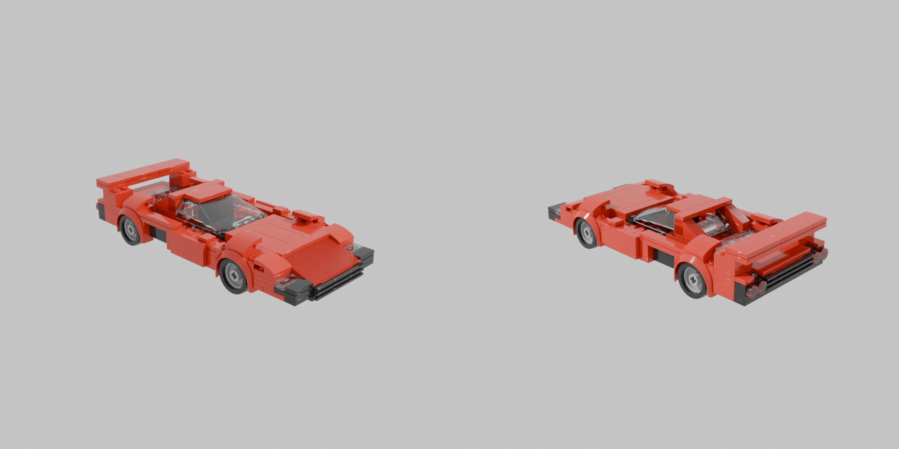

# Car2LEGO_3D

独立探索 **生图 → 图片重建 3D → 物理规格校准 → 乐高模型 → Studio .io** 的本地研究项目。
从 [Car2LEGO](https://github.com/imxiaoxian/Car2LEGO) 的图片参考、真实零件和独立验收设计出发，将显式 3D 网格作为新的中间表示。

```text
文字描述 + 车辆规格 → SD-Turbo 图片 → 去背景 → TripoSR 3D 网格
                                                ↓
                              物理尺寸校准 → 标准车辆零件拟合
                                                ↓
                                     LDraw + BOM → Studio .io
```

默认 `car` 策略使用网格条件下的跑车零件先验，生成原生轮组、玻璃、斜坡、进气口、座椅和尾翼。
它是有限零件家族的近似拟合，不是通用网格到任意乐高装配的恢复算法。
`plates` 策略保留早期的车形板件雕塑路线，便于对照。
当前仍未达到参考图的外观交付标准，未验证实体拼装、碰撞、转向或开门机构。
实际复现的版本、耗时、显存、结果和限制见 [复现记录](docs/reproduction.md)。



上图来自完整实跑，`appearance_accepted=false`。早期板件样例保留在 `examples/f40/`。

## 安装（Windows）

需要 Git、[uv](https://docs.astral.sh/uv/)、Python 3.11。CUDA 运行使用 NVIDIA GPU，测试机器为 RTX 4060 Laptop 8GB。

```powershell
git clone https://github.com/imxiaoxian/Car2LEGO_3D.git
cd Car2LEGO_3D
powershell -ExecutionPolicy Bypass -File scripts/setup.ps1 -Python 3.11
```

脚本创建 `.venv`，安装 PyTorch 2.5.1 CUDA 12.4 和固定依赖，下载并固定 TripoSR 源码。
首次运行会下载模型权重到 Hugging Face 缓存和背景移除权重到 rembg 缓存，需联网及数 GB 磁盘空间。
没有全局修改 Python / Conda 环境，不要求 OpenAI API 密钥。显存不足时可用 `--device cpu`，速度更慢。

如果 Git 配置了失效代理，修复本机代理，或仅在本次克隆临时使用 `git -c http.proxy= -c https.proxy= clone ...`。

## 本地生成页面与品牌选择

需要 Node.js 22.12+（本机使用 24）。完成 Python 环境安装后运行：

```powershell
powershell -ExecutionPolicy Bypass -File scripts/start-web.ps1
```

打开 http://127.0.0.1:8765；端口占用时追加 `-Port 8766`。
页面直接复用 Car2LEGO 的品牌选择器和目录，收录 396 个品牌的中文名与本地 Logo，
支持热门/全部、中文/英文/别名搜索。列表底部固定“其他”，选择后可输入自定义品牌。
目录包含现存、历史及商用品牌，不保证穷尽全球所有品牌；数据来源和更新方式见
[品牌目录](docs/vehicle-brand-catalog.md)。原项目 `D:\lego` 不参与本项目运行，也不会被修改。

页面提交品牌、车型、颜色、比例和种子，实际调用上述完整 CLI 流程；完成后可下载
Studio `.io`、LDraw 和 3D 网格。任务参数、日志和产物保存在 `runs/web/<任务ID>/`，
刷新页面可恢复最近任务；同一服务每次只运行一个生成任务。
服务只监听本机地址，写入接口校验同源请求。

当前默认 Ferrari F40 1:24 草稿使用已核对规格。其他比例只展示不同的设计要求，
缺少独立配方时禁止生成。其他车型可选择自定义车长研究草稿，品牌名会进入生图，
但通用跑车配方不保证该车型的外观或尺寸还原；品牌目录不等同于规格/配方支持目录。
页面初始图片是已有 F40 草稿渲染，本次生成后展示参考图片和重建网格，不能替代
Studio GUI、原生零件碰撞或外观验收。

前端开发：在后端运行时，在 `frontend` 目录执行 `npm run dev`（API 代理到 8765）。
单独启动已构建页面：`.venv/Scripts/python.exe -m car2lego3d web --port 8765`。
浏览器验收截图、测试和页面实际生成记录见 [验证记录](docs/brand-selector-validation.md)。

## 完整流程

```powershell
.venv/Scripts/python.exe -m car2lego3d run `
  --prompt "a red Ferrari F40 sports car, realistic proportions, black tires" `
  --seed 42 --steps 4 --resolution 256 --length-studs 24 --strategy car --color 4 `
  --vehicle-specs data/vehicles/ferrari_f40_1987.json --output runs/f40
```

从已有图片开始：

```powershell
.venv/Scripts/python.exe -m car2lego3d run `
  --image path/to/car.png --output runs/my-car --length-studs 24 --strategy car
```

输入应是单个完整汽车、清楚边缘、三分之四视角和简单背景，不能是拼图或多视图面板。
默认去背景；透明 PNG 复用 alpha。`--no-remove-bg` 适用于已正确居中、灰色背景的图。
`run` 要求空输出目录，避免覆盖旧实验。单独阶段可复用已有图片或网格：

```powershell
.venv/Scripts/python.exe -m car2lego3d image --prompt "a red sports car" --output runs/image
.venv/Scripts/python.exe -m car2lego3d reconstruct --image runs/image/reference.png --output runs/mesh
.venv/Scripts/python.exe -m car2lego3d lego --mesh runs/mesh/mesh.glb --output runs/lego --length-studs 24 --strategy car
.venv/Scripts/python.exe -m car2lego3d studio --ldraw runs/lego/model.ldr --output runs/studio
```

重建分辨率支持 64 / 128 / 192 / 256，默认 128；`--chunk-size 4096` 控制密度查询分块。
网格上方向默认 Z，其他模型可设置 `--up-axis y`；`--yaw` 旋转水平方向。
转换通过水平主成分方向将车身长轴放到 X。
`car` 当前支持 23–32 studs 长度和 8 / 10 / 12 studs 核心宽度，`--width-studs` 可覆盖选择。
提供规格时，`--scale 1:24` 保留精确目标比例，分别报告网格取整误差；与 `--length-studs` 互斥。
自定义长度仍按核心车长 `length_studs × 8mm` 定义比例，并选择最近比例档的要求。
宽度先按实车比例规划，不可实现的宽度/比例会明确阻止推理，不压回当前零件家族。
不提供规格时默认 8 studs 宽度，轴位置来自网格低侧暗色区域假设。
`--color 4` 在 `car` 中只覆盖车身颜色，在 `plates` 中覆盖全部颜色；`--no-rear-wing` 去除尾翼。
生图会检查 SD-Turbo 的 77-token 上限，提示词过长时报错。

## 物理规格与测量

F40 的整体尺寸、轴距、轮距、前后轮胎规格已核对原厂宣传册和倍耐力资料。
规格 JSON 对每个值记录单位、来源和 `manufacturer / measured / estimated / unknown` 状态。
门长、玻璃大小和倾角尚无可靠数值，保留为空。可通过 `measure` 命令输入正交侧视图标注。
数据来源、换算公式和标注方法见 [物理参数说明](docs/physical-priors.md)。

尺寸先验用于提示词和网格边界校准，并约束乐高宽度、轴距。
轮胎/玻璃保留标准零件原有尺寸；`dimensions.json` 报告无法满足的目标，不缩放真实 LEGO 零件。

## 分比例要求

| 比例 | 细节和机构目标 | 当前状态 |
| --- | --- | --- |
| 1:38 | 可辨识外观、透明座舱、四轮滚动，内饰可简化 | 要求与规划已设置，独立配方未实现 |
| 1:24 | 完整外观、简化内饰与发动机舱、前后盖开合 | 可生成草稿，开盖等机构未验收 |
| 1:16 | 精细座舱、双门开合、前轮转向 | 要求与规划已设置，独立配方未实现 |
| 1:12 | 分层车身、精细底盘与发动机、独立悬挂 | 要求与规划已设置，独立配方未实现 |

尺寸容差、必需物理资料、视图计划和每步零件上限分别设置，见 [分比例要求](docs/scale-requirements.md)。
这些是设计目标，不代表功能已经实现。1:8 / 1:10 仍未开放。

```powershell
.venv/Scripts/python.exe -m car2lego3d requirements --vehicle-specs data/vehicles/ferrari_f40_1987.json --output runs/requirements
```

新规格运行保存规则快照和逐项报告，缺资料、未测量或未验证机构不会被标记为交付通过。
`--scale 1:24` 已完整实跑，见 `examples/f40-scale-1-24/`；上述旧样例保留原结果，不自动改验收标签。

## 输出

| 路径 | 内容 |
| --- | --- |
| `00-vehicle/spec.json` | 本次物理规格快照（仅规格模式） |
| `00-requirements/requirements.json` | 首次模型调用前保存的比例要求与网格规划（规格模式） |
| `01-image/reference.png`、`image.json` | 生图与提示词、种子、权重版本、耗时、哈希 |
| `02-mesh/input.png`、`foreground.png` | 实际重建输入和去背景结果 |
| `02-mesh/mesh.glb`、`mesh.obj` | TripoSR 带顶点颜色网格 |
| `02-mesh/reconstruction.json` | 重建参数、面数、封闭性、耗时、显存、哈希 |
| `02-mesh/calibrated.glb`、`calibrated-mm.obj` | 长宽高先验校准网格；GLB 用米，OBJ 用毫米；原始网格保留 |
| `02-mesh/physical-calibration.json` | 独立 XYZ 缩放与校准边界记录 |
| `03-lego/model.ldr` | 标准零件 LDraw 与阶段 `0 STEP`；阶段不是已验证拼装说明书 |
| `03-lego/inventory.csv` | 零件编号、LDraw 颜色编号、数量；不是 BrickLink 颜色编号 |
| `03-lego/assembly.json`、`fit.json` | 零件放置、网格证据、拟合参数；`fit.json` 仅 `car` |
| `03-lego/dimensions.json` | 比例、轴距、轮距、轮胎等目标和当前零件偏差（规格模式） |
| `03-lego/requirements.json`、`requirements-report.json` | 本次采用的分比例标准、尺寸/资料/步骤/机构/证据检查（规格模式） |
| `03-lego/mesh-preview.png` | 重建网格静态预览 |
| `03-lego/validation.json` | 当前策略的数字检查与未验证状态 |
| `04-studio/model.io`、`studio.json` | ZIP .io 与颜色/变换/步骤回读校验 |

在 BrickLink Studio 中打开 `model.io` 检查真实零件、接触和层序。
归档回读不等于 Studio GUI、原生碰撞或实物验收。
`buildability=unverified` 是当前统一状态，即使占用覆盖和连接图通过，也没有实物认证。

## 验证与研究

```powershell
.venv/Scripts/python.exe -m car2lego3d doctor
.venv/Scripts/python.exe -m pytest -q
.venv/Scripts/python.exe scripts/verify_examples.py
```

测试验证坐标轴适配、非等距体素比例、颜色覆盖、stud 图、LDraw 坐标/旋转和透明预处理。
还验证规格单位与来源、轮胎外径换算、轴距约束、真实侧面连接变换和 `.io` 无损回读。
真实模型推理结果在 `examples/` 中，不能以构造测试代表模型质量。
开源方案比较及后续路线见 [调研](docs/research.md)。

安装了 ldraw-mcp、Blender、ImportLDraw 和零件库时，可用 `scripts/render_native.py`
生成真正的零件渲染和哈希记录。这个可选工具不打包第三方运行环境；参数见 `--help`。

## 许可

本项目代码 MIT；模型、依赖和第三方资产各有许可证，见 [THIRD_PARTY_NOTICES.md](THIRD_PARTY_NOTICES.md)。
仓库不包含模型权重、原项目密钥、Studio 零件库或 Python 环境。
