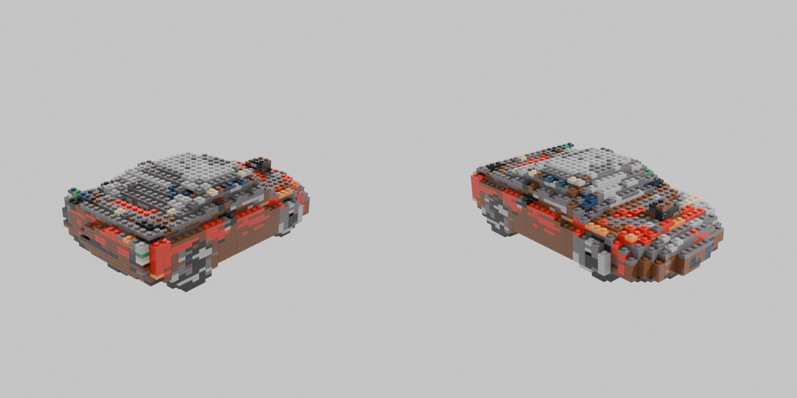

# Car2LEGO_3D

独立探索 **生图 → 图片重建 3D → 网格生成乐高模型** 的本地研究项目。
从 [Car2LEGO](https://github.com/imxiaoxian/Car2LEGO) 的图片参考、真实零件和独立验收设计出发，将显式 3D 网格作为新的中间表示。

```text
文字描述 → SD-Turbo 图片 → 去背景 → TripoSR 3D 网格
                                    ↓
                 8 × 8 × 3.2 mm 体素 → 标准板件 → LDraw + BOM + 数字检查
```

当前产物是车形板件雕塑：保留网格轮廓和近似颜色，使用真实标准板件编号。
没有实现可转车轮、Technic 机构、自动精细曲面匹配或实物拼装认证。
实际复现的版本、耗时、显存、结果和限制见 [复现记录](docs/reproduction.md)。



上图是第一版实测输出，颜色噪声和阶梯曲面仍明显，尚未达到精细车型复刻效果。

## 安装（Windows）

需要 Git、[uv](https://docs.astral.sh/uv/)、Python 3.11。CUDA 运行使用 NVIDIA GPU，测试机器为 RTX 4060 Laptop 8GB。

```powershell
git clone https://github.com/imxiaoxian/Car2LEGO_3D.git
cd Car2LEGO_3D
powershell -ExecutionPolicy Bypass -File scripts/setup.ps1 -Python 3.11
```

脚本创建 `.venv`，安装 PyTorch 2.5.1 CUDA 12.4 和固定依赖，下载并固定 TripoSR 源码。
首次运行会下载模型权重到 Hugging Face 缓存和背景移除权重到 rembg 缓存，需联网及数 GB 磁盘空间。
没有全局修改 Python / Conda 环境，不要求 OpenAI API 密钥。显存不足时可用 `--device cpu`，速度更慢。

如果 Git 配置了失效代理，修复本机代理，或仅在本次克隆临时使用 `git -c http.proxy= -c https.proxy= clone ...`。

## 完整流程

```powershell
.venv/Scripts/python.exe -m car2lego3d run `
  --prompt "a red Ferrari F40 sports car, realistic proportions, black tires" `
  --seed 42 --steps 4 --resolution 128 --length-studs 32 `
  --output runs/f40
```

从已有图片开始：

```powershell
.venv/Scripts/python.exe -m car2lego3d run `
  --image path/to/car.png --output runs/my-car --length-studs 32
```

输入应是单个完整汽车、清楚边缘、三分之四视角和简单背景，不能是拼图或多视图面板。
默认去背景；透明 PNG 复用 alpha。`--no-remove-bg` 适用于已正确居中、灰色背景的图。
`run` 要求空输出目录，避免覆盖旧实验。单独阶段可复用已有图片或网格：

```powershell
.venv/Scripts/python.exe -m car2lego3d image --prompt "a red sports car" --output runs/image
.venv/Scripts/python.exe -m car2lego3d reconstruct --image runs/image/reference.png --output runs/mesh
.venv/Scripts/python.exe -m car2lego3d lego --mesh runs/mesh/mesh.glb --output runs/lego --length-studs 32
```

重建分辨率支持 64 / 128 / 192 / 256，默认 128；`--chunk-size 4096` 控制密度查询分块。
网格上方向默认 Z，其他模型可设置 `--up-axis y`；`--yaw` 旋转水平方向。
转换通过水平主成分方向将车身长轴放到 X，以 X 跨度确定 8mm stud 比例。
默认从顶点颜色匹配有限 LDraw 调色板；`--color 4` 强制红色，便于比较几何。

## 输出

| 路径 | 内容 |
| --- | --- |
| `01-image/reference.png`、`image.json` | 生图与提示词、种子、权重版本、耗时、哈希 |
| `02-mesh/input.png`、`foreground.png` | 实际重建输入和去背景结果 |
| `02-mesh/mesh.glb`、`mesh.obj` | TripoSR 带顶点颜色网格 |
| `02-mesh/reconstruction.json` | 重建参数、面数、封闭性、耗时、显存、哈希 |
| `03-lego/model.ldr` | 标准板件 LDraw；按高度层写入 `0 STEP` |
| `03-lego/inventory.csv` | 零件编号、LDraw 颜色编号、数量；不是 BrickLink 颜色编号 |
| `03-lego/assembly.json`、`lego.glb` | 板件放置数据与包围盒预览 |
| `03-lego/mesh-preview.png`、`lego-preview.png` | 静态对比图；板件图使用近似盒几何 |
| `03-lego/validation.json` | 体素过滤、覆盖、重叠、垂直 stud 连通和下层支撑报告 |

在 BrickLink Studio 中导入 `model.ldr` 检查真实零件、接触和层序。
`buildability=unverified` 是当前统一状态，即使占用覆盖和连接图通过，也没有实物认证。

## 验证与研究

```powershell
.venv/Scripts/python.exe -m car2lego3d doctor
.venv/Scripts/python.exe -m pytest -q
.venv/Scripts/python.exe scripts/verify_examples.py
```

测试验证坐标轴适配、非等距体素比例、颜色覆盖、stud 图、LDraw 坐标/旋转和透明预处理。
真实模型推理结果在 `examples/` 中，不能以构造测试代表模型质量。
开源方案比较及后续路线见 [调研](docs/research.md)。

## 许可

本项目代码 MIT；模型、依赖和第三方资产各有许可证，见 [THIRD_PARTY_NOTICES.md](THIRD_PARTY_NOTICES.md)。
仓库不包含模型权重、原项目密钥、Studio 零件库或 Python 环境。
