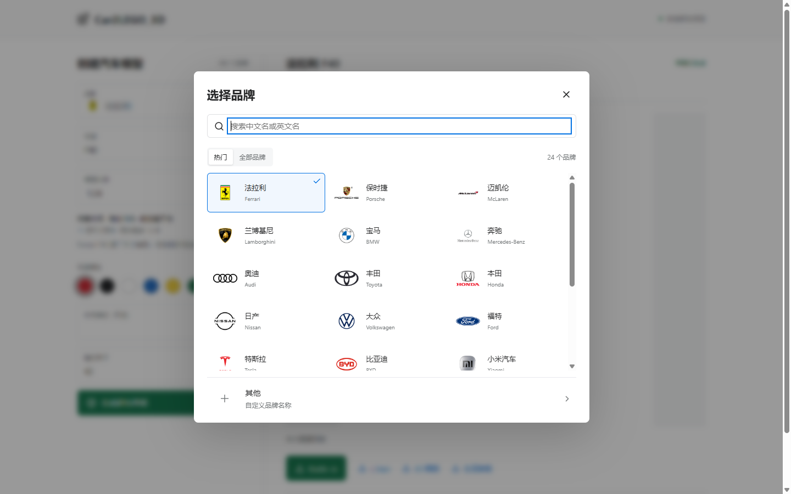
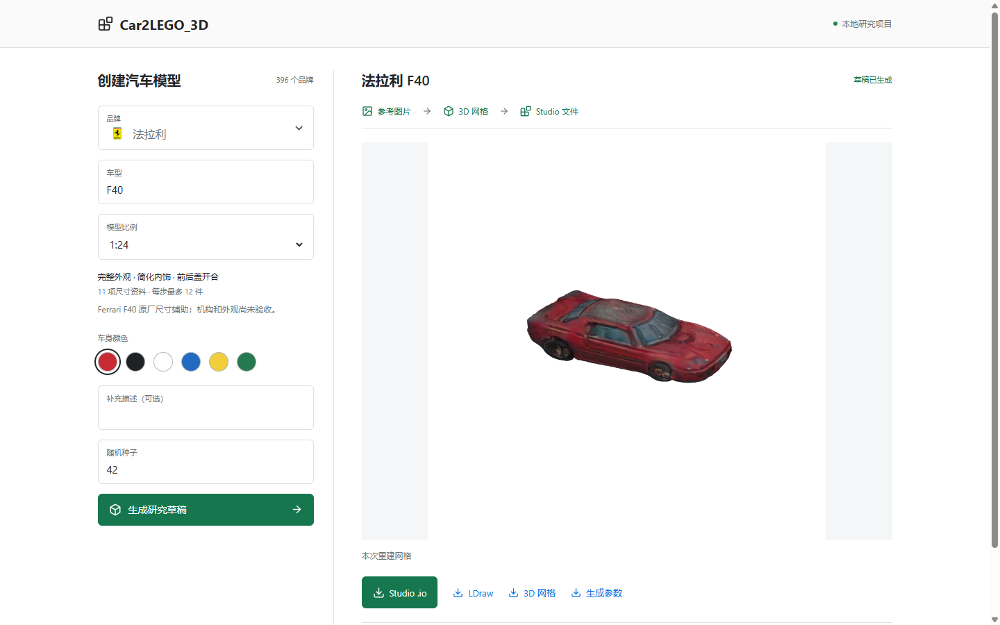

# 品牌选择与页面实跑记录

验证日期：2026-10-14。独立目录 `D:\Car2LEGO_3D`；原项目 `D:\lego` 没有修改。按用户要求只交付桌面端。

## 复用与目录

品牌组件、搜索逻辑、396 条目录及中文映射与原文件哈希一致。396 个品牌 ID 唯一，全部 Logo 文件存在且 SHA-256 与目录一致。同步脚本只调整根目录和运行说明。

## 本地验证

- `npm run build`：TypeScript 检查和 Vite 生产构建通过。
- `.venv/Scripts/python.exe -m pytest -q`：72 项通过，14 条既有 matplotlib/pyparsing 弃用警告。任务层测试使用模拟进程；下面的完整流程另行实际运行。
- `.venv/Scripts/python.exe scripts/verify_examples.py`：59 个已有样例哈希及 LDraw/BOM 数量通过。
- agent-browser 实际页面：中文“奔驰”检索、英文“BMW”检索、全部目录 396 条、无匹配结果时选择“其他”、自定义输入“星河汽车”、切回宝马移除自定义输入、唯一匹配回车选择、焦点恢复、Esc 关闭。
- 1440×900、1264×625 桌面视口：品牌名称与 Logo 正常显示，列表内部滚动，“其他”始终可见。
- 1:16 选中后生成按钮禁用；该比例未实现的配方不会启动模型。品牌选择不会自动补造物理规格。
- 浏览器无页面错误；页面刷新后恢复最近任务与下载链接。

## 实际完整流程

从页面提交 Ferrari / F40 / 红色 / 1:24 / seed 42，调用真实 SD-Turbo、TripoSR、物理规格校准、LEGO 转换与 Studio 导出。

- 任务 ID：`9418fbd9ec484614a56bb826c7151503`。
- 总耗时：106.136 秒，包含网络检查与本地缓存回退。
- 输出：`runs/web/9418fbd9ec484614a56bb826c7151503/artifacts/04-studio/model.io`。
- 234 件真实零件引用、27 个步骤。
- HTTP 下载字节与本地 `.io` 一致；ZIP 完整性检查通过，LDraw 归档回读通过。
- `.io` SHA-256：`657316fd9088900e79d2f0714aeabebc315fecd7b63fbe29028091b0235d0783`。
- `request.json` 保存标准品牌 `Ferrari`、中文名 `法拉利`、目录 ID `ferrari` 及实际生图提示词。

这次验证确认品牌选择进入生成流程和下载有效，不代表外观、Studio GUI、机构或实物拼装验收通过。保留 `appearance_accepted=false`、`delivery_accepted=false`、`buildability=unverified`。
