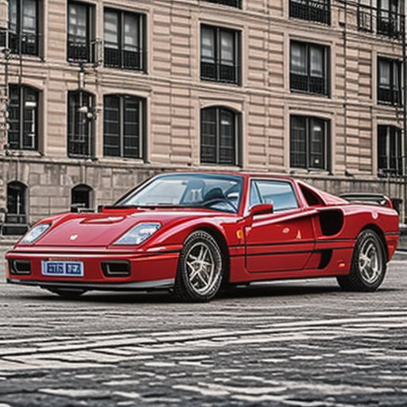
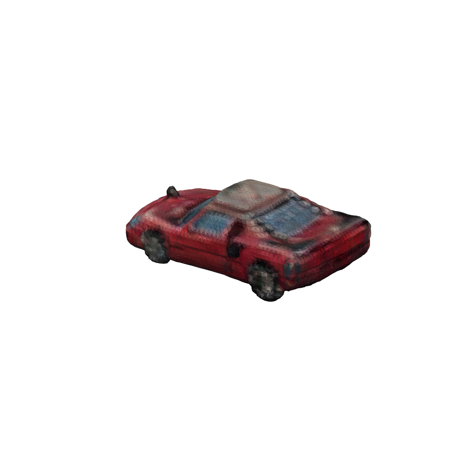
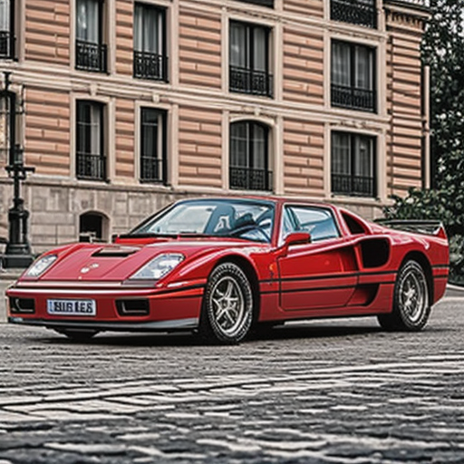
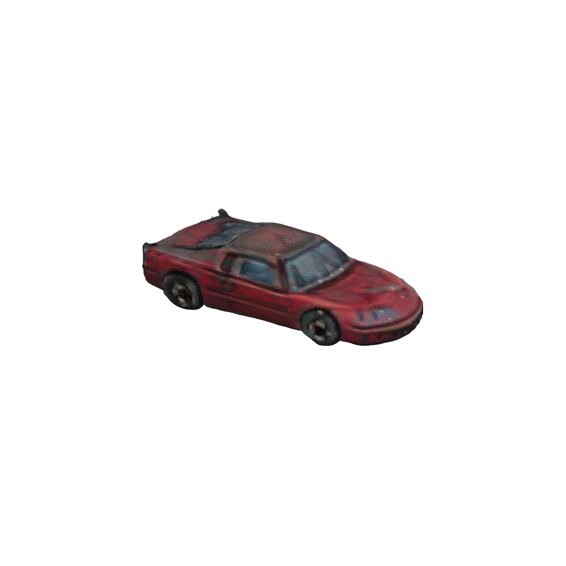

# 实际复现记录

日期：2026-10-14。所有下列图片、网格、模型和 JSON 均由本机运行生成，不是替代模型或论文演示结果。

## 环境与版本

- Windows 11（系统版本 10.0.26200）、16GB 内存。
- NVIDIA GeForce RTX 4060 Laptop GPU，8,188 MiB 显存；驱动 560.76。
- Python 3.11.5；PyTorch 2.5.1+cu124；torchvision 0.20.1+cu124。
- TripoSR 源码：`107cefdc244c39106fa830359024f6a2f1c78871`。
- TripoSR 权重：`5b521936b01fbe1890f6f9baed0254ab6351c04a`。
- SD-Turbo 权重：`b261bac6fd2cf515557d5d0707481eafa0485ec2`。
- DINO 配置、其余依赖见 `models.lock.json`、`requirements.lock.txt` 与产物 JSON。

## 早期板件流程（历史对照）

```powershell
.venv/Scripts/python.exe -m car2lego3d run `
  --prompt "a red Ferrari F40 sports car, realistic proportions, black tires, transparent windows" `
  --seed 42 --resolution 128 --length-studs 32 --strategy plates `
  --output runs/f40-release --device cuda:0
```

最终完整命令退出码为 0，`pipeline.json` 为 `completed`；带缓存模型权重的整条命令记录耗时 **54.277 秒**。
阶段计时与整条命令不同：整条命令还包含各独立进程的解释器启动、模块导入与退出等开销。
这是单机样例实测，不是严格多次平均性能基准。

| 阶段 | 最终样例记录 |
| --- | --- |
| SD-Turbo | 512×512，4 步，种子 42；8.763 秒；PyTorch 分配显存峰值 3,096.28 MiB |
| TripoSR | 去背景，float32 CUDA 推理，128 marching-cubes 分辨率，4,096 查询分块；19.729 秒；显存峰值 1,866.54 MiB |
| 网格 | 9,548 顶点、19,088 三角面，`watertight=true`，2 个网格组件 |
| 乐高转换 | 32×18 studs、25 板层；8,345 个占用体素；2,683 个真实板件编号；4.317 秒 |
| 占用检查 | 0 重叠、0 遗漏、0 多余体素 |
| Stud 连接 | 6 个组件，大小为 2,666 / 6 / 6 / 3 / 1 / 1；149 个非地面板件没有下层直接支撑 |
| 外部零件库 | 全部 2,683 个零件识别成功，缺失零件 0，未知颜色 0 |
| 真实零件渲染 | Blender 4.5.14 + ldraw-mcp；45° / 135°，每视图 640px，24 samples；已查看渲染结果 |

显存峰值指 PyTorch 分配内存，不包含桌面程序、CUDA 驱动及其他进程。
第一次生图阶段包含模型下载，耗时 341.478 秒；不能当作推理性能。最终记录使用缓存权重。






图片提示词没有完全约束背景，去背景后汽车边缘仍需要检查。单图重建可以辨认汽车形状，但纹理中的高光、阴影和背面推断降低了颜色与车型细节的准确性。网格中的轮胎被转换为板件雕塑，没有实际可转车轮。

## 单色对照

对同一份 `mesh.glb`，强制 `--color 4`：

```powershell
.venv/Scripts/python.exe -m car2lego3d lego `
  --mesh examples/f40/02-mesh/mesh.glb --color 4 --length-studs 32 --strategy plates `
  --output runs/f40-uniform-control
```

实测 813 个板件、1 个 stud 组件、61 个非地面板件没有下层直接支撑；转换计时 2.154 秒。
这说明当前颜色硬分区影响了板件合并和连接，但一次对照不能证明整体方法更优。
统一红色会丢失玻璃、车轮等信息，不作为默认质量修复。

## 上游样例复现

```powershell
.venv/Scripts/python.exe -m car2lego3d reconstruct `
  --image external/TripoSR/examples/chair.png --resolution 64 `
  --device cpu --output runs/upstream-chair
```

成功退出，19.252 秒，2,407 顶点 / 4,814 面，封闭网格。
该样例验证 CPU 路径与 Windows 网格适配可以运行；低分辨率结果不代表上游完整质量。

## 早期代码和产物验证

- 本机 10 项测试通过：非等距网格比例、对角长轴对齐、逐体素颜色覆盖、stud 连接、重叠报告、LDraw 旋转和层高、marching-cubes 轴约定、透明预处理、原模型导入、彩色 GLB 到完整导出。
- `scripts/verify_examples.py` 校验 13 个记录中的文件 SHA256，以及 LDraw / BOM / 装配 JSON 的数量一致性。
- 使用真实 LDraw 渲染发现并修正了长方形板件的轴映射：长轴在 LDraw X 方向；当前零件表与本机标准 `.dat` 文件的外框尺寸一致。
- GitHub Actions 配置 CPU 几何与导出测试。它不运行生图或神经网络重建；不以 CI 通过声称模型质量。

## 早期结论

**生图 → 真实开源图片重建 → 乐高板件模型的技术流程已跑通。**
当前彩色样例仍有断连、下层支撑、颜色噪声及细节损失问题，不能标记为可搭建成品。
`buildability=unverified`、`studio_verified=false`、`physical_verified=false` 保留在所有报告中。
没有进行 Studio GUI 碰撞审查、实物搭建、承重、机构或严格车型相似度评测。

下一阶段应先解决网格部件分割与颜色去光照，再联合优化板件覆盖和跨层连接，最后引入真实轮组、底盘和曲面零件。

## 物理规格约束的完整流程

以下是本次更新后的实际完整运行，包含生图、TripoSR、尺寸校准、车辆零件拟合和 Studio 归档。
与上面的历史板件结果分开保存在 `examples/f40-physical/`。

```powershell
.venv/Scripts/python.exe -m car2lego3d run `
  --prompt "a red Ferrari F40 sports car, black tires, transparent windows" `
  --seed 42 --steps 4 --resolution 256 --length-studs 24 `
  --strategy car --color 4 --vehicle-specs data/vehicles/ferrari_f40_1987.json `
  --output runs/f40-physical-delivery --device cuda:0
```

完整命令成功退出，`pipeline.json` 为 `completed`，记录耗时 **64.209 秒**（缓存权重，单次运行）。
规格快照、原始网格、校准网格、零件模型和 `.io` 均随样例发布。

| 阶段 | 本次实测 |
| --- | --- |
| SD-Turbo | 512×512，4 步，种子 42；12.512 秒；显存峰值 3,096.61 MiB；56/77 tokens，无提示词截断 |
| TripoSR | CUDA float32，256 分辨率，4,096 查询分块；25.769 秒；显存峰值 2,378.54 MiB |
| 原始网格 | 39,892 顶点 / 79,768 三角面，`watertight=true` |
| 尺寸校准 | 4430 / 1980 / 1130 mm；保留原始网格；GLB 使用米，OBJ 使用毫米 |
| LEGO | 246 个原生零件，35 个不同编号；10-stud 核心宽度；前后轴位置 5.5 / 18.5 studs |
| Studio 归档 | 17 个步骤标记；颜色、变换、零件与步骤回读一致；GUI 打开尚未验证 |
| 原生渲染 | Blender / ImportLDraw，135° / 315°，每视图 900px、32 samples；缺失零件 0，已查看渲染 |






统一名义缩尺为 **1:23.073**，核心车长 192 mm。当前零件家族的尺寸偏差如下：

| 量 | 缩尺后的目标 | 当前名义值 | 偏差 |
| --- | --- | --- | --- |
| 车宽与车身核心宽 | 85.815 mm | 80 mm | −6.776% |
| 轴距 | 106.185 mm | 104 mm | −2.058% |
| 前胎外径 | 27.209 mm | 24 mm | −11.795% |
| 后胎外径 | 28.878 mm | 24 mm | −16.892% |
| 后胎宽度 | 14.519 mm | 11.2 mm | −22.861% |

车宽目标对应实车整体宽度，但当前报告只比较矩形核心，不包含轮拱、门皮和后视镜，
不能当作最终模型整体外框的误差。8-stud 核心的对应偏差约 −25.421%，只是名义核心宽的对照。
轮胎名义直径来自规格换算，不是受载实测值。实际轮组、车门和风挡仍受固定零件家族限制。
门窗尺寸、风挡倾角和前后悬没有可靠值，规格中保留为未知；侧视图标注工具的测试使用构造数据，
没有将其包装成 F40 实测数据。来源和测量方法见 [physical-priors.md](physical-priors.md)。

关键产物 SHA256：

| 文件 | SHA256 |
| --- | --- |
| `00-vehicle/spec.json` | `3b83c632067c0b017a330e0961a89f2366d9418f452851ea00857ded5b33491f` |
| `03-lego/model.ldr` | `c1721523cd18dfe497dfa984e52e9d73f9882f0146514fc728653a94338857ac` |
| `04-studio/model.io` | `9bc7422eb20293fce71ef99ebf0ca99786ce57313096ff4efc0f7cd453c15473` |

本次代码验证为 **34 项测试通过**，覆盖原有网格和板件路径，以及物理规格、单位、来源、
轮胎推导、网格单位导出、轴距约束、8/10/12 宽度家族、侧面连接变换、标注测量和 Studio 归档回读。
样例校验脚本检查各阶段哈希、规格快照、原生渲染以及 LDraw / BOM / 装配数量一致性。

**完整技术流程可复现，外观仍未达到用户参考图标准。** 生图已出现车型细节偏差，单图重建也有纹理和形状损失；
标准零件拟合仍是有限跑车先验，未恢复真实 F40 CAD，也未验证开门、转向、碰撞或实物拼装。
`appearance_accepted=false`、`studio_open_verified=false`、`physical_verified=false` 保持独立。

## 分比例规则与精确 1:24 实跑

新增规则版本为 `car2lego3d-scale-v1`，四档详细要求见 [分比例说明](scale-requirements.md)。
`examples/scale-requirements/requirements.json` 是生成的要求和车型规划，不能解释成四个已完成模型。
历史样例与哈希未回写。

```powershell
.venv/Scripts/python.exe -m car2lego3d run `
  --prompt "a red Ferrari F40 sports car, black tires, transparent windows" `
  --seed 42 --steps 4 --resolution 256 --scale 1:24 --strategy car --color 4 `
  --vehicle-specs data/vehicles/ferrari_f40_1987.json `
  --output runs/f40-scale-1-24 --device cuda:0
```

完整运行成功，记录 **89.580 秒**，产物保存于 `examples/f40-scale-1-24/`。
本次启动时 Hugging Face 版本查询超时后加载了缓存权重，不能把总耗时当作纯推理基准。
SD-Turbo 阶段记录 28.240 秒；TripoSR 阶段 41.812 秒，39,892 顶点 / 79,768 面。
本次同提示词和种子的生图与重建仍实际执行，没有用已有网格代替推理。

采用精确目标比例 1:24，网格核心为 **23 × 10 studs**，239 件零件，28 个步骤。
最多每步 12 件；LDraw、装配 JSON 和 `.io` 回读一致。
原生 135° / 315° 渲染成功，缺失零件 0，已查看结果；外观仍未达到参考标准。

| 名义尺寸检查 | 偏差 | 1:24 要求 | 状态 |
| --- | --- | --- | --- |
| 核心长度 | −0.316% | 3% | 名义值在容差内 |
| 核心宽度 | −3.030% | 5% | 名义值在容差内；不含完整外框 |
| 轴距 | +1.878% | 3% | 名义值在容差内 |
| 前胎外径 | −8.251% | 5% | 超差 |
| 后胎外径 | −13.552% | 5% | 超差 |
| 后胎宽度 | −19.761% | 10% | 超差 |
| 整车高度 | 未测量 | 5% | 不通过 |
| 风挡下宽、斜高、倾角 | 缺实车资料 | 5% / 5% / 5° | 不通过 |

规则快照 SHA256：`45f5329000429be1c76ea0f5b9a3c655bef695fc134885d6253e9592bf663d71`。
`.io` SHA256：`e3c34fdbdab9d91ed845cc241cf511452d4ca019f916c9d5625a4cb7b0d4a8d8`。
名义容差内不等于原生零件完整几何通过。四轮滚动、前盖/发动机盖开合、视图、碰撞、
连接、外观、Studio GUI 和实物均未取得本次验收证据，`delivery_accepted=false`。
测试共 **47 项通过**，新增各档独立规划、精确缩尺、角度保持、规则快照一致性、
缺资料/超差报告、未实现档位在推理前退出、步骤拆分和 Studio 导出一致性测试。
