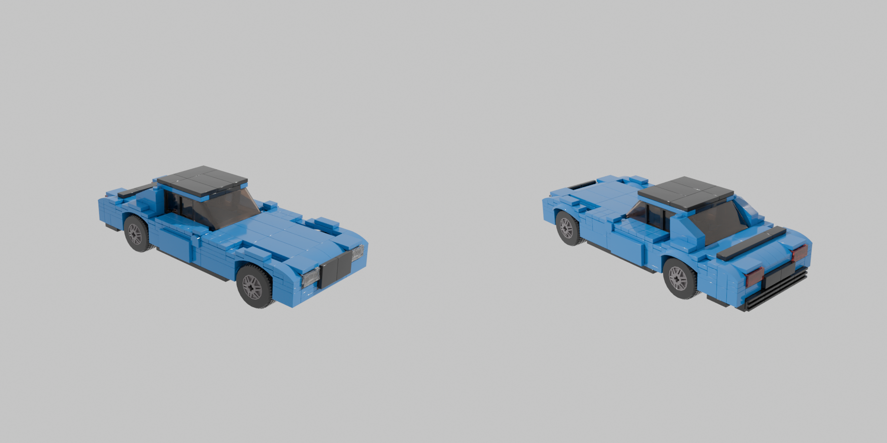
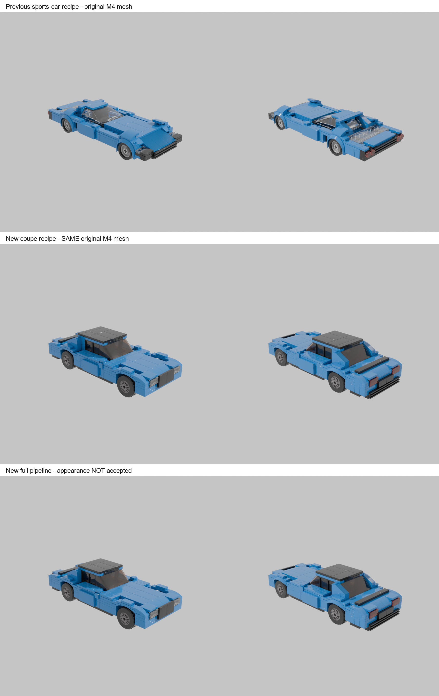

# BMW M4 Coupe Draft

New full text-to-image-to-3D-to-LEGO-to-Studio experiment, 2026-10-14.
`04-studio/model.io` contains 328 native parts, 36 steps and the actual rendered
thumbnail. This is an appearance-unaccepted research draft, not a build certificate.

`comparison-before` and `comparison-after` retain the original M4 mesh and specification
snapshot under the old/new conversion algorithms. `controlled-comparison.json`
records the exact hashes. The combined comparison's last row is the new complete run.

The sourced variant is the G82 480 hp rear-wheel-drive coupe; measurements came from
Auto-Data during the earlier live skill search and were recovered after its timeout.
SD-Turbo still generated an older-looking front. The G82 grille is an explicit recipe
prior; accurate model appearance, Studio GUI, mechanisms and physical build are
unverified. See [experiment details](../../docs/coupe-fitting.md).
